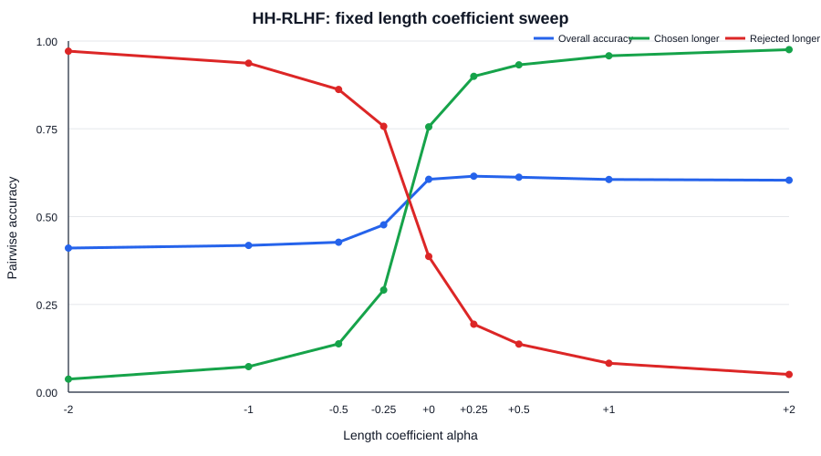

# HH-RLHF 长度偏差实验报告

数据来自 Anthropic HH-RLHF `helpful-base`。长度系数 alpha 作用于标准化后的
`len(chosen) - len(rejected)`。alpha 为负时偏向短回答，为零时忽略显式长度，
为正时偏向长回答。alpha 由验证集评测，测试集只用于最终报告。

## 数据

- 训练偏好对：8000
- 验证偏好对：2000
- 测试偏好对：2354
- 训练集中 chosen 更长比例：0.5951
- 测试集中 chosen 更长比例：0.5956

## 固定长度系数消融

内容分数由 TF-IDF 词袋偏好模型给出，alpha 是额外的长度校准项。

| alpha | Accuracy | Chosen-long acc | Rejected-long acc | Slice gap | Longer selected |
|---:|---:|---:|---:|---:|---:|
| -2.00 | 0.4104 | 0.0371 | 0.9711 | 0.9340 | 0.0338 |
| -1.00 | 0.4180 | 0.0728 | 0.9369 | 0.8641 | 0.0689 |
| -0.50 | 0.4269 | 0.1377 | 0.8620 | 0.7243 | 0.1378 |
| -0.25 | 0.4766 | 0.2910 | 0.7572 | 0.4662 | 0.2717 |
| +0.00 | 0.6062 | 0.7557 | 0.3866 | 0.3691 | 0.6979 |
| +0.25 | 0.6151 | 0.8994 | 0.1936 | 0.7058 | 0.8622 |
| +0.50 | 0.6121 | 0.9322 | 0.1369 | 0.7953 | 0.9046 |
| +1.00 | 0.6058 | 0.9579 | 0.0824 | 0.8755 | 0.9418 |
| +2.00 | 0.6037 | 0.9757 | 0.0503 | 0.9254 | 0.9653 |

验证集选择的 alpha：**+0.50**

## 线性与非线性内容模型

| Model | Accuracy | Chosen-long acc | Rejected-long acc | Slice gap | Longer selected |
|---|---:|---:|---:|---:|---:|
| content_only | 0.6062 | 0.7557 | 0.3866 | 0.3691 | 0.6979 |
| mlp_content_only | 0.5688 | 0.6744 | 0.4112 | 0.2632 | 0.6393 |

## 学习长度系数与重采样

| Model | Learned alpha | Accuracy | Chosen-long acc | Rejected-long acc | Slice gap |
|---|---:|---:|---:|---:|---:|
| joint | +0.4401 | 0.6138 | 0.9230 | 0.1551 | 0.7679 |
| balanced_resampling | +0.1706 | 0.6206 | 0.8631 | 0.2631 | 0.6000 |

## 解释口径

- Accuracy 衡量 chosen 是否获得更高奖励。
- Slice gap 衡量 chosen 更长与 rejected 更长两组的准确率差距，越小越平衡。
- Longer selected 衡量模型选择较长回答的频率，它不是质量指标，需要结合 Accuracy 看。
- 固定 alpha 消融隔离了长度项的因果影响。重采样实验检验数据层面的长度平衡。

## 来源

- 数据：https://huggingface.co/datasets/Anthropic/hh-rlhf
- 论文：https://arxiv.org/abs/2204.05862

