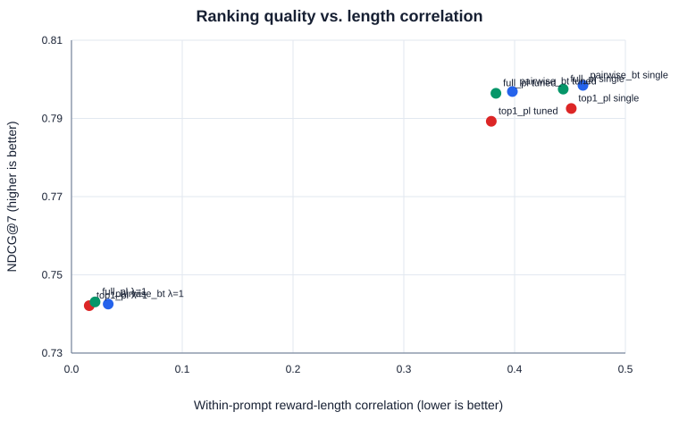

# ODIN × PL 正则强度消融

ODIN 原论文使用强度 1。本实验对 CPU 线性头不直接假设该尺度可迁移，
只在验证集上扫描强度；长度相关与正交惩罚使用同一个系数。

选择规则：先要求质量头 `|reward-length r| ≤ 0.40`，
再在满足条件的候选中选择验证集 NDCG@7 最高者。测试集只在选择完成后评测。

## 验证集扫描（三个 seed）

| Loss | λ | Top-1 | NDCG@7 | Reward-length r |
|---|---:|---:|---:|---:|
| pairwise_bt | 0.001 | 0.3990 | 0.8030 | +0.3886 |
| pairwise_bt | 0.005 | 0.3060 | 0.7460 | +0.0190 |
| pairwise_bt | 0.010 | 0.3050 | 0.7451 | +0.0217 |
| pairwise_bt | 0.020 | 0.3097 | 0.7465 | +0.0279 |
| pairwise_bt | 0.050 | 0.3080 | 0.7473 | +0.0343 |
| pairwise_bt | 0.100 | 0.3123 | 0.7492 | +0.0436 |
| pairwise_bt | 1.000 | 0.3080 | 0.7444 | +0.0379 |
| top1_pl | 0.001 | 0.4067 | 0.8043 | +0.4401 |
| top1_pl | 0.005 | 0.4053 | 0.8005 | +0.3909 |
| top1_pl | 0.010 | 0.3727 | 0.7839 | +0.2568 |
| top1_pl | 0.020 | 0.3110 | 0.7479 | +0.0328 |
| top1_pl | 0.050 | 0.3183 | 0.7488 | +0.0313 |
| top1_pl | 0.100 | 0.3223 | 0.7502 | +0.0401 |
| top1_pl | 1.000 | 0.3203 | 0.7495 | +0.0452 |
| full_pl | 0.001 | 0.3893 | 0.8005 | +0.3767 |
| full_pl | 0.005 | 0.3013 | 0.7464 | +0.0278 |
| full_pl | 0.010 | 0.3033 | 0.7457 | +0.0245 |
| full_pl | 0.020 | 0.3077 | 0.7461 | +0.0312 |
| full_pl | 0.050 | 0.3057 | 0.7473 | +0.0383 |
| full_pl | 0.100 | 0.3077 | 0.7460 | +0.0340 |
| full_pl | 1.000 | 0.3040 | 0.7416 | +0.0220 |

## 选定强度的测试集结果（五个 seed）

| Loss | λ | Top-1 | Pairwise | NDCG@7 | Reward-length r | Longest selected |
|---|---:|---:|---:|---:|---:|---:|
| pairwise_bt | 0.001 | 0.3862 | 0.6384 | 0.7969 | +0.3980 | 0.3566 |
| top1_pl | 0.005 | 0.3692 | 0.6250 | 0.7893 | +0.3789 | 0.3484 |
| full_pl | 0.001 | 0.3856 | 0.6370 | 0.7964 | +0.3831 | 0.3532 |

## 条件切片：tuned ODIN 如何缩小 gap

| Loss | Head | 最佳即最长 | 最佳非最长 | Gap |
|---|---|---:|---:|---:|
| pairwise_bt | single | 0.5355 | 0.3044 | +0.2311 |
| pairwise_bt | tuned ODIN | 0.5049 | 0.3177 | +0.1873 |
| top1_pl | single | 0.5055 | 0.2968 | +0.2086 |
| top1_pl | tuned ODIN | 0.4667 | 0.3129 | +0.1537 |
| full_pl | single | 0.5322 | 0.3054 | +0.2269 |
| full_pl | tuned ODIN | 0.4918 | 0.3243 | +0.1675 |

小 λ 的 tuned ODIN 不再像 λ=1 那样完全向下拉平，但主要改善仍来自降低‘最佳即最长’切片的优势；
‘最佳非最长’切片只小幅改善。它缓和了模型依赖长度顺风局的程度，没有把困难切片变成容易切片。

该表应与 `report.md` 中的单头基线以及 λ=1 直接迁移结果一起阅读。
若 λ 的轻微变化导致指标突然恶化，应解释为当前小模型上的优化敏感性，而不是隐藏它。